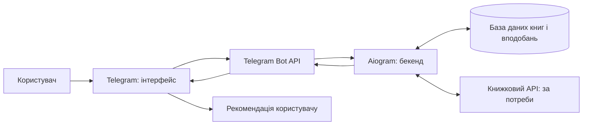

# Архітектура застосунку для підбору книг

## Призначення продукту

Проєкт — Telegram-бот, який допомагає користувачу підібрати книгу за його бажаннями: ключовими словами, настроєм і жанром. Наприклад, користувач може шукати загадкову історію про ліс або веселий детектив.

Наразі бот відповідає на команди `/start`, `/help`, `/age` і `/about`. Обробки запиту на підбір книги, каталогу книг і бази даних у проєкті поки немає. Описані нижче функції показують, як можна розвинути продукт.

## Основні блоки системи

| Блок | Роль у застосунку | Приклад у цьому проєкті |
| --- | --- | --- |
| **Фронтенд** | Інтерфейс, через який користувач вводить побажання та переглядає рекомендації. | Telegram-застосунок на телефоні або комп’ютері. Користувач пише боту, натискає кнопки й читає відповіді. Окремого вебфронтенду зараз немає. |
| **Бекенд** | Приймає запит, обробляє побажання, шукає відповідні книги й формує відповідь. | Python-застосунок на aiogram. Він обробляє команди та повідомлення Telegram. |
| **API** | Дає системам змогу обмінюватися даними. | Telegram Bot API передає повідомлення між Telegram і ботом. У майбутньому можна під’єднати зовнішній книжковий API для отримання каталогу й описів книг. |
| **База даних** | Зберігає каталог книг та дані, потрібні для персоналізації: обране, оцінки й історію пошуку. | У поточному проєкті бази даних ще немає. Її можна додати для збереження каталогу та вподобань користувачів. |

Telegram — це інтерфейс, яким користується читач. Telegram Bot API — канал, через який бекенд отримує повідомлення і надсилає відповіді. Зовнішній книжковий API, якщо його під’єднати, буде окремим джерелом книжкової інформації.

## Потік даних

Користувач надсилає побажання в Telegram. Telegram передає його через Bot API до застосунку на aiogram. Бекенд шукає відповідні книги в базі даних або, якщо буде підключено зовнішній каталог, через книжковий API. Після цього він надсилає рекомендації користувачу через Telegram.

Спрощено: **користувач → Telegram → Telegram Bot API → бекенд → база даних → бекенд → API → Telegram → рекомендація користувачу**. Зовнішній книжковий API є додатковим джерелом даних; базу можна використовувати без нього, наприклад із власним каталогом.

## Приклади функцій

Це типові функції застосунків для пошуку й вибору книг, які можна додати до цього бота. У поточному коді вони ще не реалізовані.

### 1. Пошук за ключовими словами

- **Фронтенд:** користувач надсилає слова на кшталт «ліс», «таємниця» або «міфи» в Telegram.
- **Бекенд:** виділяє слова із запиту й шукає їх у назвах, описах або темах книг.
- **API:** Telegram Bot API доставляє запит і повертає відповідь; за потреби зовнішній книжковий API шукає в ширшому каталозі.
- **База даних:** зберігає каталог книг і поля для пошуку — назви, описи, авторів і теми.

### 2. Підбір за настроєм

- **Фронтенд:** користувач обирає настрій, наприклад веселий, сумний або загадковий, кнопкою чи текстом.
- **Бекенд:** зіставляє настрій із позначками книг і ранжує результати.
- **API:** Telegram Bot API передає вибір і надсилає список рекомендацій.
- **База даних:** зберігає настрої або теги, пов’язані з кожною книгою.

### 3. Фільтр за жанром

- **Фронтенд:** користувач обирає жанр — наприклад, детектив, роман чи історія.
- **Бекенд:** фільтрує каталог за жанром і, за наявності інших побажань, поєднує фільтри.
- **API:** Telegram Bot API передає вибір жанру й повертає результати.
- **База даних:** зберігає жанри книг і зв’язок між книгами та жанрами.

### 4. Збереження книги в обраному

- **Фронтенд:** користувач натискає кнопку «Зберегти» біля рекомендації та може пізніше відкрити список обраного.
- **Бекенд:** додає або видаляє книгу зі списку конкретного користувача.
- **API:** Telegram Bot API передає натискання кнопки й надсилає підтвердження.
- **База даних:** зберігає зв’язок користувача з обраними книгами.

### 5. Оцінка рекомендації

- **Фронтенд:** користувач оцінює книгу або відповідає, чи підійшла рекомендація.
- **Бекенд:** записує оцінку й може врахувати її в майбутньому підборі.
- **API:** Telegram Bot API передає оцінку до бота та доставляє відповідь.
- **База даних:** зберігає оцінки та історію рекомендацій для покращення персонального підбору.

## Поточний стан і можливий розвиток

Зараз Telegram забезпечує інтерфейс, а Python-застосунок на aiogram обробляє команди й надсилає відповіді через Telegram Bot API. Щоб бот справді рекомендував книги, наступними кроками можуть бути каталог книг, логіка пошуку за ключовими словами, настроєм і жанром, а згодом — база даних для обраного та оцінок. Зовнішній книжковий API можна під’єднати, якщо власного каталогу буде недостатньо.
